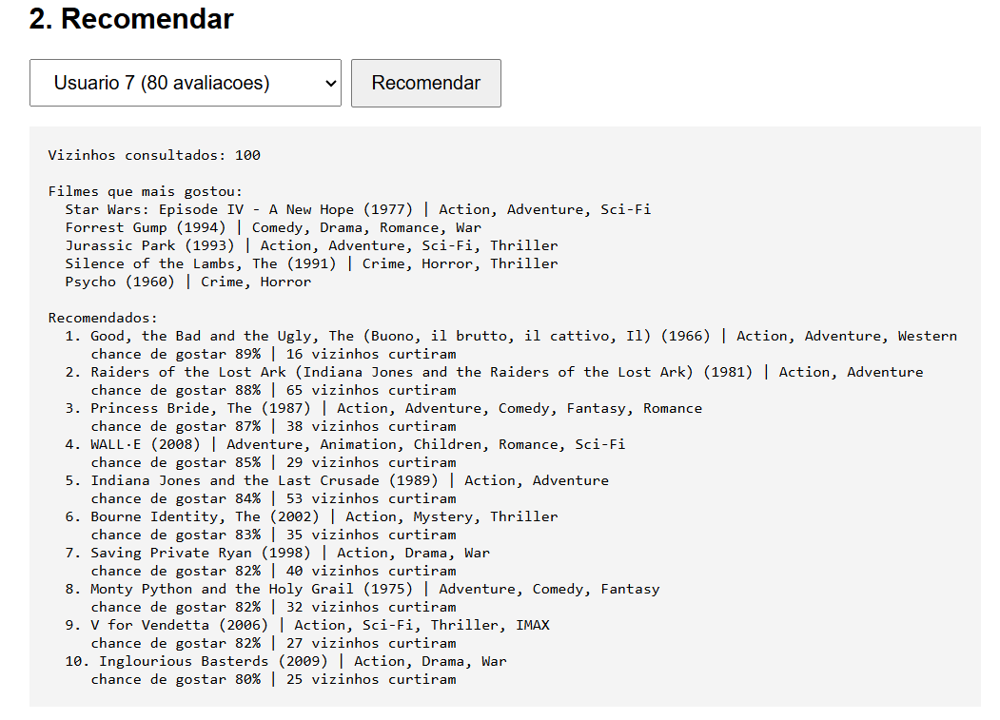

# Recomendacao de Filmes com TensorFlow.js e ChromaDB

Sistema de recomendacao de filmes que combina um banco vetorial (ChromaDB) para achar usuarios parecidos com uma rede neural (TensorFlow.js) para ranquear os filmes. Projeto da pos em Engenharia de Software com IA Aplicada.



## Como funciona

```
Pagina (porta 3000) -> Servidor Node (porta 3001) -> ChromaDB (porta 8000)
```

1. **Vetores:** cada filme vira uma lista de 20 numeros (18 generos em multi-hot, ano e nota media normalizados). O perfil do usuario e a media dos vetores dos filmes que ele curtiu (nota 4 ou mais).
2. **Treino:** a rede neural (64, 32 e 1 neuronio) recebe `[perfil do usuario, vetor do filme]` e aprende a prever se ele vai gostar. O filme avaliado e removido do perfil durante o treino, para a resposta nao vazar na entrada.
3. **Banco vetorial:** os vetores de filmes e usuarios ficam no ChromaDB com distancia por cosseno.
4. **Recomendacao:** o ChromaDB devolve os 100 usuarios mais parecidos. Os filmes que eles curtiram e o usuario ainda nao viu viram candidatos, e a rede ranqueia os 10 melhores.

## Tecnologias

TensorFlow.js, ChromaDB, Node.js, Express e Docker.

## Como rodar (Windows)

Pre-requisitos: Node.js e Docker Desktop.

1. Baixe o `ml-latest-small.zip` em https://grouplens.org/datasets/movielens/latest/ e coloque `movies.csv` e `ratings.csv` em `data/raw`
2. Instale e prepare os dados:

```bash
npm install
npm run prepare-data
```

3. Suba o banco e salve os vetores:

```bash
docker compose up -d
npm run index-vectors
```

4. Em dois terminais:

```bash
npm run server
```
```bash
npm start
```

5. Abra `http://localhost:3000`, clique em **Treinar modelo**, escolha um usuario e clique em **Recomendar**.

## Resultados

| Metrica | Valor |
|---|---|
| Acerto chutando sempre "gostou" | 59,4% |
| Acerto da rede na validacao | cerca de 68,5% |

A rede ficou cerca de 9 pontos acima do chute. O acerto de treino e o de validacao ficaram proximos, sem sinal de overfitting.

## Limitacoes

- Gostos muito variados viram uma media. Um usuario que gosta de generos diferentes tende a receber recomendacoes do grupo mais forte.
- A nota media do filme e uma das entradas, entao filmes bem avaliados em geral ganham vantagem.
- As porcentagens servem para ranquear, e nao sao probabilidades calibradas.
- A qualidade foi avaliada olhando as listas, sem teste formal de ranking.
- Foram usados os 300 filmes mais avaliados e os usuarios com pelo menos 20 avaliacoes entre eles.

## Dados e creditos

Dataset MovieLens (GroupLens Research, Universidade de Minnesota). Os arquivos `data/movies.json` e `data/users.json` sao um recorte transformado desse dataset. Os termos de uso do MovieLens pedem uso nao comercial, citacao e que transformacoes sejam distribuidas sob as mesmas condicoes. Confira o `README.txt` que vem no zip.

> F. Maxwell Harper and Joseph A. Konstan. 2015. The MovieLens Datasets: History and Context. ACM Transactions on Interactive Intelligent Systems 5, 4, Article 19. https://doi.org/10.1145/2827872

A ideia de combinar banco vetorial com rede neural veio da aula do professor Erick Wendel.

## Estrutura

```
data/              dados em JSON (os CSVs originais ficam em data/raw, fora do git)
scripts/           conversao do MovieLens para JSON
server/            servidor Node e integracao com o ChromaDB
src/               codificacao, rede neural, recomendacao e tela
docker-compose.yml ChromaDB
```
